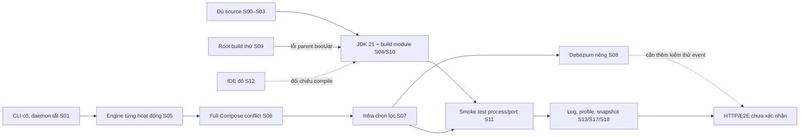

# Thiết kế “Hiểu và chạy dự án”

Ngày khảo sát: **04/11/2026**, múi giờ **Asia/Bangkok**. Trạng thái bàn giao: **thiết kế để review, chưa triển khai**.

Đối tượng: FE React/TypeScript mới học Java Backend. Trải nghiệm đi từ toàn cảnh → vấn đề → quyết định → thao tác → kết quả → cách tự kiểm tra, rồi mới mở sâu lệnh, file và bằng chứng.

## 1. Kết quả đọc và đối chiếu

### 1.1. Nguồn, phạm vi và giới hạn

Đã đọc toàn bộ [báo cáo bằng chứng](D:/tmp/agent-service-workspaces-setup-evidence-report.md), gồm timeline S00–S18, chi tiết lịch sử, phần A, phần B và danh sách khoảng trống. Báo cáo mang ngày 04/11/2026; không cung cấp giờ chính xác cho mọi sự kiện. Báo cáo là nguồn lịch sử của thiết kế này; lượt này không trực tiếp truy cập transcript gốc.

Đã đọc phần environment trong [journeys.ts](../src/content/journeys.ts), contract [model.ts](../src/content/model.ts), điều hướng/nội dung/flow/source/inspector trong [JourneyWorkspace.tsx](../src/JourneyWorkspace.tsx), shell [App.tsx](../src/App.tsx), lưu tiến độ [state.ts](../src/state.ts), source viewer, CSS, README, tài liệu tái sử dụng và các browser test liên quan.

Đã đọc source/build/config được dẫn ở mục 1.3–1.5 tại `D:\ALPACA\agent-system`; kiểm tra sự tồn tại của repo con, module và JAR. Đã đọc cấu hình PostgreSQL/connector trên đĩa, **không kết nối DB**. Đã thử mở `http://localhost:3182/journey/environment` bằng browser context riêng: `ERR_CONNECTION_REFUSED`. Vì thế đánh giá giao diện hiện tại dựa trên source; chưa xác nhận hình thức/interaction trên server đang chạy trong lượt này. Không tự start server.

Không chạy Gradle, Java app, Docker CLI, container, HTTP API Java, SQL, migration hoặc installer; không sửa repo Java, `.idea`, cấu hình máy hay Git config; không commit/push/deploy. Thay đổi duy nhất của lượt thiết kế là tài liệu này. Không có AGENTS.md được tìm thấy trong các thư mục cha đã kiểm tra hoặc cây source liên quan. Skill `gitnexus-exploring` được dùng để định hướng khảo sát; danh sách GitNexus chỉ có `core-insurance-portal`, không có hai repo mục tiêu. Không index repo; chuyển sang `rg`/đọc file trực tiếp.

### 1.2. Quy tắc phát biểu bằng chứng

Không dùng một nhãn “verified” cho cả lịch sử, file hiện tại và runtime. Trong tài liệu và UI đề xuất:

| Nhãn thiết kế | Ý nghĩa | Không được suy ra |
|---|---|---|
| **BC-H** | Báo cáo ghi nhận lịch sử, nhãn gốc [H] | Lượt này đã chạy lại; còn nguyên raw output |
| **BC-F** | Báo cáo ghi nhận đối chiếu [F] **ở thời điểm lập báo cáo** | Đã kiểm tra mới trong lượt thiết kế |
| **MỚI** | Lượt này trực tiếp đọc file/artifact hoặc nhận kết quả kiểm tra được ghi rõ | File chứng minh runtime/API đang hoạt động |
| **SL** | Suy luận, ghi rõ căn cứ và giới hạn | Kết luận đã được chạy thử |
| **THIẾU** | Chưa có bằng chứng cần thiết | Thất bại kỹ thuật đã được chứng minh |

Mỗi kết luận có nguồn riêng; một bước có thể đồng thời chứa BC-H, MỚI và THIẾU. Giữ nguyên nhãn [H]/[F]/[I]/[G] của báo cáo bên trong inspector nguồn, kèm xuất xứ và ngày. Không “nâng” [F] cũ thành MỚI khi chưa đọc lại đúng đối tượng. Khi source hiện tại khác lịch sử, hiển thị hai quan sát; không viết lại sự kiện cũ.

### 1.3. Đối chiếu workspace, build và IDE

Trong bảng dưới, các path Java tương đối tính từ `D:\ALPACA\agent-system`.

| Nhận định | Báo cáo ghi nhận | Đối chiếu mới và giới hạn |
|---|---|---|
| Repo cha chưa đủ source khi vừa clone | S00–S03: `workspaces` ban đầu trống/chưa đủ repo con; người dùng chạy script clone (BC-H) | **MỚI:** `settings.gradle:1` đặt tên `agent-workspaces`; dòng 2–37 include module bên dưới `workspaces`; hiện có 10 nested `.git`. Không thể kiểm tra lại trạng thái trống ban đầu từ cây hiện tại |
| Chọn script clone | S02 chọn `git-cmd.sh`, không chọn `init-shared.sh` | **MỚI:** script đầu trỏ nhóm `agent-system`, có target `1-shared`, 7 infrastructure repo, `agent-service`, `agent-integration-service`; script sau trỏ `sale-system`. Chỉ đưa target vào UI, che private remote |
| Còn thiếu `swagger-service` | S03, báo cáo §6.4 (BC-F) | **MỚI:** `settings.gradle:27` có include; script clone không có target này; `Test-Path` trả false. Đối chiếu tất cả include chỉ thấy target này thiếu. **THIẾU:** chưa xác nhận nhu cầu của module này; lịch sử build 5 app không đủ để tuyên bố toàn workspace đầy đủ |
| Java 17 → 21 | S01 có Java 17.0.18; S04 xác nhận Gradle dùng Temurin 21.0.13 (BC-H) | **MỚI:** `build.gradle:46–49` đặt toolchain 21; `gradle/wrapper/gradle-wrapper.properties:3` chọn 8.14.3. Không chạy `java -version` hay wrapper trong lượt này; không xác nhận JDK đang được terminal dùng |
| Root build lỗi | S09: `clean assemble` lỗi `:workspaces:bootJar` do không tìm main class (BC-H) | **MỚI:** root `bootJar` tắt ở `build.gradle:26–28`, nhưng Spring Boot plugin áp cho mọi subproject ở dòng 34–38; không có `workspaces/build.gradle`/main app riêng được thấy trong danh mục source liên quan. **SL:** phù hợp nguyên nhân virtual parent nhận `bootJar`. Không tái hiện lỗi; không kết luận root build hiện vẫn thất bại qua một lần chạy mới |
| 5 module build thành công | S10 (BC-H), artifact (BC-F) | **MỚI:** 5 JAR `*-0.0.1-SNAPSHOT.jar` còn, bên cạnh `*-plain.jar`; metadata ở bảng sau. JAR hiện hữu không chứng minh source hiện tại vừa compile hoặc test đã pass |
| IntelliJ đỏ, compile khác kết quả IDE | S12: SDK/Gradle JVM 21 nhưng language/target từng 17; sau là 21 (BC-H/BC-F) | **MỚI:** `.idea/misc.xml:4` SDK/language 21, `.idea/compiler.xml:50` bytecode 21, `.idea/gradle.xml:8` Gradle JVM 21; annotation processing có khai báo. `build.gradle:69–70` có Lombok. **THIẾU:** ai thay `.idea`, IDE đã reload hay hết đỏ chưa |
| Giới hạn Git | S18 bị unsafe repository, không sửa global config (BC-F) | **MỚI:** `git --no-optional-locks status --short` tại root và cả 10 nested repo trả exit 0, không có dòng thay đổi. Đây là trạng thái mới, không phủ nhận lỗi unsafe trong báo cáo; không suy ra ai đã thay môi trường/config. Ứng dụng học hiện không có `.git` riêng |

Metadata JAR đọc mới từ filesystem (không mở/chạy JAR; thời gian sửa file không phải thời gian boot):

| Ứng dụng | Thư mục module dưới `workspaces/` | Kích thước JAR boot, byte | LastWriteTime filesystem |
|---|---|---:|---|
| Command | `agent-service/1-agent-command-service` | 154136893 | 2026-11-04 11:41:26 |
| Flow | `agent-service/2-agent-flow-service` | 151593056 | 2026-11-04 11:41:49 |
| Query | `agent-service/3-agent-query-service` | 133352506 | 2026-11-04 11:42:08 |
| Integration | `agent-integration-service/agent-integration-service` | 132224714 | 2026-11-04 11:42:30 |
| Kafka CDC | `2-infrastructure/kafka-cdc-service` | 85929169 | 2026-11-04 12:02:12 |

### 1.4. Đối chiếu Docker và CDC

**BC-H:** CLI có sẵn nhưng daemon ban đầu tắt; sau đó daemon chạy được. Full Compose từng lỗi conflict `/rebrow`, với các tên `redis`, `rabbitmq`, `rebrow`, `debezium` của project khác. Agent chuyển sang infrastructure chọn lọc và Debezium riêng; connector/task từng RUNNING. Người mở Docker Desktop chưa xác định.

**MỚI từ `docker-compose-env.yml`:** có tên container cố định ở RabbitMQ (dòng 5), Kafka (25), Kafka UI (35), Debezium (48), Redis (67), Rebrow (73). PostgreSQL write/read map 5432/5433; Kafka 9092; Zookeeper 2181; Kafka UI 8080. Debezium **trong file Compose** map **8086 → 8083** (dòng 55), trong khi **container riêng trong lịch sử S08** là **18086 → 8083**. Không đồng nhất hai cấu hình này. Thêm `-p agent-system` không tự đổi `container_name` cố định hoặc giải quyết mọi conflict port.

**MỚI:** `build.gradle:97–104` còn Gradle Docker Compose extension với `projectName = "sale-platform"`. Vì vậy UI không khuyến nghị dùng task Compose của Gradle như thể nó có cùng project name với lệnh Docker CLI đề xuất ở phần B. Chưa chạy task nào để xác nhận hành vi thực tế.

**MỚI bổ sung so với báo cáo:** tìm thấy `docker/cdc-config/connector_request.json`. Các dòng 3–23 có slot `alpaca_slot`, PostgreSQL connector `pgoutput`, database `alpaca-event`, schema `platform_event`, table `platform_event.events`, topic prefix `platform`; tên `platform-event-buf` ở dòng 13/25. File chứa cấu hình nhạy cảm nên chỉ nhập các trường đã chọn và che vào nội dung học. **THIẾU:** không có bằng chứng đây là đúng payload đã POST vào container riêng S08, hoặc đúng network/host đang dùng khi đó. Không hiển thị như cấu hình tái tạo Debezium đã xác minh.

**MỚI:** `docker/postgres/Dockerfile:1–6` dùng image PostgreSQL của Debezium và copy config/init scripts. `postgresql.conf.sample:8–10` cấu hình logical WAL/replication slots; `docker-entrypoint-initdb.d/1.initialize-database.sql:1–3` khai báo logical slot và schema. Chúng là ý định cấu hình trên đĩa, không chứng minh đã áp lên volume hiện có. Chưa thấy bằng chứng vận hành đồng bộ **write 5432 → read 5433** trong các file đã đọc. Logical CDC sang Kafka không tự chứng minh replication giữa hai DB.

**BC-F tại thời điểm lập báo cáo:** Docker daemon và các Java service đều dừng. **Lượt này không kiểm tra lại runtime Java/Docker**; không hiển thị “hiện đang dừng” với thời gian khảo sát mới. Dòng đúng: “Khi lập báo cáo ngày 04/11/2026: Docker và Java đã dừng; trạng thái hiện tại chưa được kiểm tra lại.”

### 1.5. Đối chiếu profile, datasource và dependency trước khi thiết kế chạy lại

Trong bảng: `C`, `F`, `Q` lần lượt là resource folder của Command/Flow/Query; `I` là resource folder của Integration; `K` là resource folder Kafka CDC. Mỗi folder là `<module>/src/main/resources/` theo bảng module ở trên. `mặc định` chỉ cấu hình `application.yml` nếu không có override, không phải profile local đã được team xác nhận. Các URL kết nối đầy đủ, private host và credentials không được đưa vào tài liệu/frontend.

| App | Đối chiếu source mới | Điều kiện cho hướng dẫn chạy lại |
|---|---|---|
| Command, 9901 | `C/application.yml:33` datasource remote; `C/application-dev.yml:33` host localhost, DB `alpaca-event`, không ghi port tường minh; schema `platform_event` dòng 45. RabbitMQ loopback:5672 (52–54), Redis loopback:6379 (119–121). `dev` vẫn có các service API ngoài máy (74–93), `alpaca.local: false` (94–95) | Bắt buộc chỉ rõ `dev`; 5432 là port PostgreSQL mặc định được suy ra, không phải literal trong URL này. `dev` không đồng nghĩa offline/toàn bộ dependency local. Kiểm tra endpoint và override thực tế trước khi chạy |
| Flow, 82 | `F/application.yml:42–49`: schema `sale_platform`, DB localhost:5432; RabbitMQ loopback. `F/application-dev.yml:30`: RabbitMQ tên host môi trường khác; dòng 42–49 đổi schema sang `platform_event`, DB localhost:5432; service API cũng khác | Không tự chuyển tất cả sang `dev`. Cả lệnh mặc định và phương án `dev` cần team xác nhận topology, broker, endpoint nội bộ; chưa có profile local chuẩn |
| Query, 9902 | `Q/application.yml:24–37`: localhost:5433, `sale_platform`, `ddl-auto: none`; `alpaca.local: true` dòng 61–62. `Q/application-dev.yml:33–46`: localhost:5432, `platform_event`, `ddl-auto: update`; `alpaca.local: false` dòng 71–72 | Default và `dev` đổi cả DB/schema/auth. Không coi thêm `dev` là cách sửa mọi lỗi. Quan hệ dữ liệu Flow/Query và replication phải được xác nhận |
| Integration, 9903 | `I/application.yml:27`: Kafka loopback:9092; dòng 39 DB localhost (không ghi port), schema `platform_event` dòng 55, RabbitMQ/Redis local. Nhiều API Core/auth bên ngoài (90–112). `I/application-dev.yml:27` dùng Kafka tên host môi trường khác | Lệnh mặc định chỉ là ứng viên theo cấu hình/lịch sử boot. Phải kiểm tra broker và external dependency theo chức năng cần học; không khẳng định Core hoạt động |
| Kafka CDC, 8911 | `K/application.yml:4,31`: `alpaca.kafka.event:9092`; topic `platform.platform_event.events` dòng 32; RabbitMQ loopback. `K/application-dev.yml:32` dùng topic khác (`sp.sale-platform.events`) | Chạy Java từ Windows cần phân giải/đi tới hostname Kafka được advertised. Chưa kiểm tra hosts/DNS/network. Không tự thêm `dev` hoặc thay topic để làm khớp |

**MỚI:** năm main class gọi `SpringApplication.run`; chưa thấy đoạn tự ép active profile trong các main/build module đã đọc. Runtime còn có thể nhận override từ environment, VM args, command line hoặc file ngoài; lượt này chưa xác nhận toàn bộ cấu hình hiệu lực.

**MỚI:** Command/Flow/Query có cấu hình `hikari.connection-init-sql`, một số profile có `ddl-auto: update`. Vì vậy **boot có thể tạo/cập nhật schema**, kể cả khi người học chỉ muốn xem port. Runbook phải mô tả tác dụng này và xác nhận DB local trước khi người học tự chạy; UI chỉ sao chép, không tự kết nối hay chạy lệnh. Không hướng dẫn chạy trực tiếp init SQL để “sửa thiếu bảng”.

**MỚI về auth:** đã đọc `ResourceServerConfiguration.java` của Command/Query/Flow/Integration. Có cấu hình opaque token; Command/Query có nhánh `alpaca.local`, một số path `/actuator/**` được permit ở Command/Query/Integration. Điều đó chưa xác nhận endpoint được expose hay trả 200, chưa chứng minh login hoặc quyền nghiệp vụ. Không hướng dẫn bật bypass auth. `PolicyWorkflow.java:23–28` có handler gọi đồng bộ read model: đây là code quan hệ, chưa phải bằng chứng event đi qua được cả chuỗi.

### 1.6. Kết luận đủ cơ sở để đưa vào trải nghiệm

- Ba blocker lịch sử được giải quyết trong phạm vi smoke test: thiếu repo con → đã clone; Java 17 không đúng yêu cầu → Gradle từng dùng 21; daemon/conflict Docker → từng chạy infrastructure chọn lọc và Debezium riêng. Nguồn chính là báo cáo; chỉ một phần được đối chiếu từ file mới.
- Root aggregate build từng lỗi; workaround build riêng 5 app đã thành công theo báo cáo. Không mô tả là đã sửa root Gradle.
- 5 app **từng boot/bind port** theo báo cáo; **chưa có bằng chứng HTTP API hoặc nghiệp vụ end-to-end**. Artifact và source mới không lấp được khoảng trống đó.
- Runbook có thể cung cấp checklist/lệnh có điều kiện. Chưa đủ căn cứ công bố một chuỗi “copy tất cả là chạy local hoàn chỉnh”. Các khoảng trống về profile Flow/Query, Debezium runtime, replication, auth/API cần giữ hiển thị.

## 2. Chặng, bước, timeline và phụ thuộc

### 2.1. Hai cách duyệt lịch sử

Chế độ A có **“Theo chặng học”** làm mặc định và **“Timeline gốc”** để đối chiếu. Chặng học gom theo chủ đề, không khẳng định thời gian. Ví dụ S12 nằm gần S04 trong chặng Java/IDE nhưng sau S11 trong timeline. Không tạo timestamp từng bước khi nguồn không có.

| Chặng | Tên trên UI | Tham chiếu | Câu hỏi người học trả lời được |
|---|---|---|---|
| C1 | Hiểu workspace và lấy đủ source | S00–S03 | Tôi clone repo cha đã có đủ code chưa? Script nào đúng? |
| C2 | Chuẩn bị Java và IDE | S04, S12 | Vì sao cần Java 21? IDE đỏ có đồng nghĩa compile lỗi? |
| C3 | Chuẩn bị Docker và xử lý conflict | S05–S08 | CLI/daemon khác gì? Vì sao không chạy nguyên stack? |
| C4 | Build và khởi động thử | S09–S11 | Root build lỗi ở đâu? Module nào từng build/boot được? |
| C5 | Tự quan sát, chọn profile và hiểu trạng thái | S13, S17–S18 | Xem log ở đâu? `dev` có tác dụng gì? Đang xem kết quả lúc nào? |

Timeline giữ thứ tự **S00 → S01 → … → S18** theo bảng §4 của báo cáo. S14–S16 xuất hiện dưới dạng đoạn thu gọn **“Khảo sát tiếp theo — ngoài setup”**, không được tính vào bước bắt buộc, tiến độ setup hoặc điều kiện chạy. Mở liên kết xem tóm tắt/nguồn: S14 Claim/FNOL survey; S15 mô hình Core giả định; S16 DB ownership giả định. Không chuyển chúng thành hướng dẫn tạo Claim/DB. “Timeline gốc” là thứ tự báo cáo, không phải raw event log có giờ chính xác.

### 2.2. Danh sách bước và cách trình bày

Actor bên dưới là **theo báo cáo**. “Agent” chỉ dùng khi báo cáo ghi nhận agent thực hiện; không suy từ việc artifact tồn tại.

| Bước | Loại học; thao tác | Trước → hành động/actor → kết quả | File/bằng chứng và cách trình bày |
|---|---|---|---|
| S00 | Setup; đọc file | Repo cha chưa đủ source → agent đọc cây/settings → nhận diện workspace aggregator | Cây tối giản theo báo cáo trước, cây đã đọc mới sau; `settings.gradle`; không dựng Git diff |
| S01 | Setup/kiểm tra; kiểm tra môi trường | Chưa biết công cụ → **người dùng** chạy version checks → Java 17, CLI có/daemon lỗi | Bảng version + trích lỗi có trong báo cáo; không tạo terminal transcript hoàn chỉnh |
| S02 | Setup; đọc file/quyết định | Chưa biết script/JDK → agent đọc Gradle và 2 script → chọn `git-cmd.sh`, yêu cầu 21 | So sánh mục tiêu script và toolchain, không diff source |
| S03 | Setup; clone | Repo con thiếu → **người dùng** chạy script (shell invocation không rõ) → repo con có, còn thiếu Swagger | Cây target trước/sau có provenance; không gán clone cho agent |
| S04 | Setup; hướng dẫn/đổi môi trường/kiểm tra | Java 17 → agent hướng dẫn, người cài/chọn JDK **chưa xác định**; người dùng xác nhận wrapper → Gradle từng dùng 21 | So sánh version/môi trường; mẫu đầy đủ ở §6.1 |
| S05 | Setup/chạy hằng ngày; đổi môi trường | CLI có, daemon tắt → Docker Desktop được mở (**actor chưa rõ**) → Engine từng chạy | Trạng thái daemon theo lịch sử; phân biệt app Docker Desktop và Engine |
| S06 | Xử lý lỗi; chạy | Mong start full Compose → agent thử → conflict `/rebrow`, chưa chạy trọn stack | Lỗi, các tên va chạm, lựa chọn tiếp tục; lệnh lịch sử không đầy đủ, không có nút copy chuỗi chứa `...` |
| S07 | Chạy hằng ngày; chạy infra | Full stack conflict → agent chọn PostgreSQL/Kafka/Zookeeper/UI, tái dùng Redis/RabbitMQ/Rebrow → nhóm dependency từng chạy | Bảng container/port và quyết định; command lịch sử thiếu, lệnh B2 đặt riêng ở runbook |
| S08 | Setup/xử lý lỗi; chạy/kiểm tra | Debezium cũ conflict → agent tạo container riêng 18086 và connector → connector/task từng RUNNING | Sơ đồ host/container port; tách file connector tìm thấy mới với payload lịch sử chưa xác nhận |
| S09 | Chẩn đoán; build | Muốn build tất cả → agent chạy root `clean assemble` → lỗi virtual parent `:workspaces:bootJar` | Task lỗi + giải thích root/parent/app; không trình bày là service compile hỏng |
| S10 | Setup/sau thay đổi; build | Root aggregate không hoàn tất → agent build 5 module → lịch sử thành công, JAR còn | Bảng module/artifact; tên task kết hợp lịch sử không còn; mẫu §6.2 |
| S11 | Kiểm chứng; chạy/kiểm tra | Có package → agent smoke test 5 app → port từng bind, sau dừng process | Matrix app/profile/port; không suy ra HTTP, auth hoặc business; exact invocation còn nhập nhằng ở báo cáo |
| S12 | Xử lý lỗi; đọc file/kiểm tra IDE | IDE đỏ dù build được → agent chẩn đoán, khuyến nghị SDK/reload/Lombok → file hiện 21, actor sửa chưa rõ | Bảng IDE settings trước/theo báo cáo và file hiện tại; không tạo `.idea` diff giả |
| S13 | Kiểm chứng; quan sát | Chưa biết log/service ở đâu → agent giải thích terminal/Run/Services/Docker → biết nơi quan sát | Hướng dẫn UI/terminal, không giả ảnh/log runtime |
| S17 | Chạy hằng ngày; đọc config/hướng dẫn | Click Run có thể dùng cấu hình mặc định remote → agent nêu Command `dev` → lệnh/config có điều kiện | So sánh profile và mục tiêu DB đã che; IntelliJ click-run chưa được xác minh |
| S18 | Kiểm chứng; đọc/kiểm kê | Dễ nhầm “từng boot” với “đang chạy” → agent lập báo cáo kiểm tra runtime → Docker/Java dừng lúc báo cáo | Snapshot có ngày/nguồn, không dùng thẻ live. Git unsafe là giới hạn lịch sử; kiểm tra Git mới lưu riêng |

### 2.3. Phụ thuộc và nhánh lỗi

Phân biệt ba loại liên kết: **thứ tự báo cáo**, **điều kiện cần để làm**, **nhánh chẩn đoán**. Không suy rằng hai bước đứng liền có dependency kỹ thuật cứng.



Sơ đồ thể hiện quan hệ học/điều kiện khái quát, không xác nhận thứ tự startup cứng giữa 5 app. Build không cần suy ra Docker phải chạy. S06/root build là nhánh lỗi lịch sử, không phải việc người tự chạy phải lặp lại. Debezium là điều kiện cho bài CDC end-to-end, chưa chứng minh là điều kiện bắt buộc để mọi process bind port.

### 2.4. Contract nội dung một bước

Tất cả bước có cùng khung câu hỏi; trường không có dữ liệu phải ghi “Chưa ghi nhận/Không áp dụng”, không bịa để lấp chỗ:

1. **Trước bước này:** trạng thái môi trường/source/kiến thức và nguồn của trạng thái đó.
2. **Vướng ở đâu, biết bằng cách nào:** vấn đề + nhận định có dẫn chứng.
3. **Ai làm gì:** từng hành động, actor/mức xác định; phân biệt đọc, hướng dẫn, thực thi.
4. **Vì sao chọn cách đó:** quyết định, phương án đã cân nhắc nếu có bằng chứng; suy luận có nhãn SL.
5. **Lệnh và nơi thực hiện:** shell/CWD/module/IDE; độ chính xác và vai trò lịch sử/hướng dẫn; có thể không có lệnh.
6. **File/cấu hình liên quan:** vai trò và đoạn dòng gắn với nhận định; không buộc phải có Java symbol.
7. **Kết quả thực tế, trạng thái sau:** quan sát được gì, ở thời điểm nào; tách khỏi “mong đợi”.
8. **Tôi tự kiểm tra thế nào:** thao tác/lệnh, expected, cách phân nhánh lỗi; các lệnh mới thuộc runbook.
9. **Nguồn và giới hạn:** báo cáo/file/metadata, raw hay tóm tắt, khoảng trống chưa lấp.
10. **Đi tiếp/quay lại:** trước/sau theo cách duyệt đang chọn; thêm liên kết lỗi hoặc runbook tương ứng có nhãn rõ.

Giải thích ngay tại chỗ, mỗi thuật ngữ một câu mở rộng được: **Gradle Wrapper** là bộ script chọn phiên bản Gradle của repo (gần với dùng package manager theo version của dự án); **toolchain** chọn JDK cho compile, phân biệt với JVM chạy Gradle/IDE; **profile** là lớp cấu hình theo môi trường, có thể đổi DB/auth/dependency; **container** là môi trường chạy dịch vụ do Docker Engine quản lý; **port** là cổng process lắng nghe, không chứng minh request đúng; **smoke test** ở lịch sử này chỉ xác nhận boot/port. Không xem các so sánh FE là mô tả kỹ thuật tương đương hoàn toàn.

## 3. Bố cục và luồng tương tác

### 3.1. Toàn cảnh trước chi tiết

Giữ route `/journey/environment`, app shell, sidebar hành trình, token màu và cách chia panel hiện tại. Lần mở route không có lựa chọn sâu sẽ vào tổng quan:

```text
Hiểu và chạy dự án                       [Sao chép liên kết]
[Agent đã làm gì?] [Tôi tự chạy lại]
Nguồn: báo cáo 04/11/2026 + đối chiếu source 04/11/2026
Build 5 module: từng đạt | Boot/port: từng đạt | HTTP: chưa có | Business: chưa có
Snapshot báo cáo: Docker/Java đã dừng lúc lập báo cáo; không phải trạng thái live

 [C1 Source] → [C2 Java/IDE] → [C3 Docker] → [C4 Build/boot] → [C5 Quan sát]
 Blocker: thiếu repo con / Java 17 / daemon & conflict → cách đã vượt qua
 Giới hạn còn: root aggregate / profile & DB / connector runtime / HTTP & E2E
 [Theo chặng học] [Timeline gốc]        [Chọn một bước để tìm hiểu]
```

Các thẻ chặng có câu trả lời ngắn, nhãn loại Setup/Xử lý lỗi/Kiểm chứng (có thể nhiều loại), mã S và kết quả đúng phạm vi. “Đã vượt qua” luôn có phạm vi lịch sử; thiếu Swagger và root aggregate không bị tô thành đã sửa. Không trộn phần trăm đã học vào các thẻ kỹ thuật.

Chọn chặng mở danh sách bước thuộc chặng; chọn bước mở nội dung và chọn node flow cùng lúc. Tổng quan có nút “Xem kết quả đã có bằng chứng” mở matrix §3.6. Giữ lối quay về tổng quan trong nội dung bước.

### 3.2. Chi tiết bước trên layout hiện có

Sidebar bước bên trái được nhóm theo 5 chặng; chặng khác có thể thu gọn. Vùng chính giữ 3 tab hiện có, đổi nhãn theo nội dung setup:

- **Diễn biến & quyết định** (`view=result`): trước → vấn đề/bằng chứng → hành động/actor/lý do → kết quả/sau; flow nhỏ và lệnh liên quan.
- **File & bằng chứng** (`view=source`): cây file/nguồn bên trái, nội dung giữa và inspector bên phải theo panel hiện có. Nguồn báo cáo và artifact là item riêng, không giả thành file code.
- **Tự kiểm tra** (`view=practice`): hướng dẫn kiểm tra có điều kiện, expected, lỗi thường gặp, ghi chú và “Tôi đã học bước này”. Hiển thị liên kết tới chế độ B tương ứng, không coi expected là actual.

Inspector thay đổi theo đối tượng đang xem nhưng luôn giữ tiêu đề “Đang học Sxx”. Gồm: câu hỏi bước; nguồn nào đang hỗ trợ nhận định nào; tác giả hành động; thời điểm/mức chính xác; đoạn dòng/file/symbol nếu có; kết luận được và không được rút ra; liên kết quay lại. Khi chọn một evidence khác, không âm thầm chuyển bước.

### 3.3. Không ép tất cả thành Before/After/Diff

| Nội dung | Renderer chính | Quy tắc |
|---|---|---|
| Clone S00/S03 | Cây thư mục trạng thái trước/sau | “Trước” tối giản theo báo cáo, không tạo danh sách file trống giả định; “sau” có ngày source mới; node thiếu hiển thị riêng |
| Java/IDE S04/S12 | Bảng phiên bản/cấu hình trước/sau | Không tạo diff source hoặc lệnh installer; phân biệt terminal/JVM/toolchain/IDE |
| Docker S06–S08 | Thẻ lỗi → lựa chọn → sơ đồ container/port → kết quả | Conflict tên khác conflict port; default Compose khác Debezium riêng |
| Build S09/S10 | Bảng task/module/actual/artifact | Root fail và targeted pass nằm cạnh nhau; build không được tự nâng thành test pass |
| S11/S18 runtime | Quan sát có thời điểm + matrix kiểm chứng | Lịch sử, không chấm xanh live |
| Source hiện tại | Một bản “Source đã đối chiếu” có dòng gốc | Cho xem đoạn đã che; không gọi đó là bản “After do agent sửa” |
| Source/config có hai snapshot thật | Diff viewer hiện có | Chỉ bật Diff khi cả hai snapshot có provenance; lượt này chưa thu được cặp như vậy |
| Không có raw output | Khối **“Tóm tắt theo báo cáo”** | Văn xuôi/bảng, không dấu nhắc terminal hoặc `BUILD SUCCESSFUL`/log tự dựng |

Lệnh lịch sử hiển thị riêng với kết quả. Chỉ lệnh đầy đủ, được phép công bố mới có nút copy. Trích dẫn báo cáo không đầy đủ có thể xem để hiểu nhưng không tạo command thực thi được bằng cách đoán. Không có nút “Run”, “Start”, “Build ngay” hay terminal kết nối máy.

### 3.4. Đồng bộ lựa chọn, URL và lịch sử trình duyệt

Tái dùng `useLocation`/`useNavigate`, không thêm router/state library. URL là nguồn chính cho ngữ cảnh chia sẻ được. Contract đề xuất:

| Tham số | Giá trị | Ý nghĩa |
|---|---|---|
| `mode` | `history` (mặc định), `rerun` | A/B, độc lập với tab `view` |
| `section` | `overview`, `detail` | Mở toàn cảnh hoặc chi tiết; thiếu step thì về overview |
| `order` | `stages`, `timeline` | Cách duyệt chế độ A |
| `stage` | `C1`…`C5` | Chặng đang mở; suy từ step khi không khớp |
| `step` | `S00`…`S18` hoặc ID `R-*` của runbook | Bước đang học; S14–S16 chỉ là nội dung khảo sát tiếp theo |
| `track` | `first`, `daily`, `build`, `diagnose` | Nhóm công việc chế độ B |
| `view` | `result`, `source`, `practice` | Tái dùng tab hiện có |
| `file`, `evidence` | ID trong dataset | Đối tượng nguồn đang xem, tối đa một item chính được ưu tiên |
| `line` | Số dòng nguyên dương | Đoạn source được mở, phải nằm trong excerpt |
| `side` | `before`, `after`, `diff` | Chỉ có hiệu lực khi item thật sự hỗ trợ snapshot/diff |

Ví dụ URL **đề xuất, chưa được triển khai**:

```text
/journey/environment?mode=history&section=detail&order=stages&step=S04&view=result
/journey/environment?mode=history&section=detail&order=timeline&step=S09&view=source&file=java-root-build&line=37
/journey/environment?mode=rerun&track=daily&section=detail&step=R-D4&view=source&evidence=E-command-dev
```

Quy tắc chuyển trạng thái:

1. Chọn step từ sidebar/flow: cập nhật step/chặng/file chính/evidence chính cùng một navigation; xóa lựa chọn dòng và `side` không áp dụng. Không giữ file của bước trước khiến inspector lệch.
2. Chọn file/evidence tham chiếu: giữ mode/track/order/step/tab, ghi điểm quay lại; chỉ đổi đối tượng inspect. Tab khác vẫn biết mình đang học bước nào.
3. Mỗi chọn có ý nghĩa tạo history entry bằng push. Chuẩn hóa URL sai/dư hoặc alias cũ dùng replace để Back không lặp qua URL lỗi. Không ghi mỗi lần resize/scroll vào history.
4. Mở bằng chứng là panel/drawer có URL, **không cần rời workspace**. Dùng browser history cho Back/Forward và stack điểm quay lại trong session. Để reload/chia sẻ vẫn có nút “Về bước Sxx”, cho phép `return` chứa một URL tương đối được kiểm tra thuộc `/journey/environment`; không tin URL ngoài origin. Nguồn gốc giữ `step`, nên thiếu session stack vẫn quay lại được ngữ cảnh bước.
5. Source scroll/focus được nhớ theo mode/step/item/side giống viewer hiện có. Cây nguồn tự mở ancestor. Khi quay lại bằng chứng, khôi phục đoạn đọc; khi người dùng chủ động chọn bước mới, focus tiêu đề bước mới.
6. Chuyển A/B: giữ URL gần nhất mỗi mode trong memory; nếu chưa có, B về chọn track, A về overview. Không ngầm đổi S04 thành bước runbook nếu chưa chọn; cung cấp link rõ “Tự kiểm tra Java”. Back trả đúng mode trước đó.
7. ID không tồn tại: thông báo thiếu item, giữ step hợp lệ hoặc về overview nếu step sai; không render non-null assertion trên `step.file`. Không tự lấy file đầu tiên rồi gọi là bằng chứng của step.

Giữ alias cho 5 deep link environment cũ: `map` → overview; `prerequisites` → S04; `start` → S07; `check` → S11; `diagnose` → S12. Đây là đường điều hướng tương thích, **không** là ánh xạ hoàn thành bài học. Chuẩn hóa bằng replace; bảo toàn tab nếu còn phù hợp, reset file demo/side không có thật kèm thông báo.

### 3.5. Responsive, accessibility và trạng thái thiếu

Giữ breakpoint/layout responsive hiện có; desktop có sidebar bước và vùng bài học, source/inspector co giãn bằng `react-resizable-panels`. Dưới breakpoint source đang có (1250px), xếp source/inspector dọc. Mobile dùng danh sách chặng thu gọn/chọn bước thay vì dàn 16 nút dài; các tab wrap hoặc cuộn trong vùng của nó, không tràn cả trang. Bảng module cho phép cuộn ngang cục bộ và có nhãn cột.

Chọn bằng bàn phím được ở step/flow/tab/cây file, giữ `aria-current`/`aria-pressed`, focus rõ; `Escape` đóng evidence drawer và trả focus về nút mở. Không dùng màu đơn độc để phân biệt lịch sử/thiếu/thất bại. Copy báo thành công/thất bại bằng `role=status`; cho chọn text thủ công khi clipboard lỗi. Giữ reduced-motion và resize bằng phím. Không có raw output, timestamp hoặc actor vẫn đọc được toàn bài; ô thiếu ghi rõ lý do, không spinner vô hạn.

### 3.6. Bốn mức kiểm chứng độc lập

Không dùng một dấu “Đã chạy được”. Matrix theo app/mục tiêu và thời điểm, không chỉ theo chặng:

| Mục tiêu | Build/package | Process boot/bind port | HTTP API phản hồi | Luồng nghiệp vụ |
|---|---|---|---|---|
| Root aggregate | **Thất bại trong lịch sử** S09 | Không áp dụng | Không áp dụng | Không áp dụng |
| Command (`dev`), 9901 | Thành công theo báo cáo S10; JAR còn | Từng boot/port theo báo cáo S11 | Chưa có bằng chứng | Chưa có bằng chứng |
| Flow (mặc định), 82 | Như trên | Từng boot/port theo báo cáo | Chưa có bằng chứng | Chưa có bằng chứng |
| Query (mặc định), 9902 | Như trên | Từng boot/port theo báo cáo | Chưa có bằng chứng | Chưa có bằng chứng |
| Integration (mặc định), 9903 | Như trên | Từng boot/port theo báo cáo | Chưa có bằng chứng | Chưa có bằng chứng |
| Kafka CDC (mặc định), 8911 | Như trên | Từng boot/port theo báo cáo | Chưa có bằng chứng | Chưa có bằng chứng |

Mỗi ô mở được evidence/giới hạn; không cộng thành “50% hệ thống chạy”. Kết quả port chỉ hỗ trợ process/network listener; phải khớp PID/log/profile mới gắn được với app đang tự kiểm tra. JAR chỉ hỗ trợ có artifact; không thay thế log compile source đang xem. HTTP nhận 401/403 là có phản hồi HTTP ở endpoint đó, chưa phải API đọc thành công/auth pass. Business cần input, expected/actual, correlation và dấu vết qua các thành phần; không thừa kế từ ô HTTP.

Trạng thái mỗi mức: `pass`, `fail`, `unknown`, `not-applicable`; thêm ngữ cảnh `historical` hay `observation`, scope/app/profile và ngày/độ chính xác thời gian. Chưa xác minh không dùng icon lỗi đỏ như một failure đã tái hiện.

Một khối snapshot riêng ghi **“Theo S18, tại thời điểm báo cáo ngày 04/11/2026: Docker/Java dừng”**. Không auto-poll, không đồng hồ xanh, không chữ “vừa kiểm tra” theo lần mở trang. Metadata source mới và runtime lịch sử có hai thời điểm khác nhau. Tiến độ “Tôi đã học” và checklist “Tôi đã tự kiểm tra” là tự khai, không được đổi matrix kỹ thuật.

## 4. Chế độ B — “Tôi tự chạy lại”

### 4.1. Phạm vi, độ sẵn sàng và bố cục

Chế độ B có 4 lựa chọn **Setup lần đầu / Chạy hằng ngày / Build sau thay đổi / Chẩn đoán khi lỗi**. Trước mỗi track, tóm tắt điều kiện và mức xác nhận. Liên kết “Vì sao có bước này?” mở S tương ứng và giữ điểm quay lại.

Mỗi thẻ runbook có: **Nơi thực hiện; điều kiện; lệnh hoặc thao tác; ý nghĩa; kết quả mong đợi; kiểm tra nếu lỗi; tác dụng/thay đổi; nguồn; mức xác nhận.** Không đặt thiếu điều kiện trong tooltip khó thấy. “Đã đối chiếu cấu trúc lệnh với file” khác “đã thực thi lại thành công”.

Ba mức cho instruction: **Có căn cứ source, chưa chạy lại**; **Có điều kiện cần xác nhận**; **Chờ thông tin, chưa có lệnh đầy đủ**. Trong thiết kế này không instruction nào được đóng dấu mới chạy thành công. Command `dev` có bằng chứng smoke test theo báo cáo; Flow/Query mặc định chỉ có bằng chứng boot lịch sử, không đủ để gọi profile local chuẩn.

Chỉ có **Sao chép lệnh** và hướng dẫn thao tác thủ công. Không có API thực thi shell, tự start/stop, proxy DB hoặc Java backend. Copy không đánh dấu hoàn tất, không tự xin quyền để chạy. Các lệnh dưới là **đề xuất cho nội dung sau triển khai**, không được thực thi trong lượt thiết kế, không được nhập vào bảng lịch sử.

### 4.2. Setup lần đầu

| ID / nguồn | Nơi và thao tác/lệnh | Ý nghĩa, kết quả mong đợi | Khi chưa đạt / điều kiện |
|---|---|---|---|
| R-F0 / S00 | Máy người học, parent folder đã chọn: clone repo cha bằng URL được team cấp; không có URL public/copy hoàn chỉnh trong dataset | Có root `settings.gradle`, `build.gradle`, `gradlew.bat`; hiểu mới có workspace shell | Không dựng URL private hay tự điền token. Repo đang có thì bỏ qua clone root |
| R-F1 / S01–S02 | PowerShell bất kỳ: `git --version`, `java -version`, `docker version`, `docker compose version`; trong root đọc settings/build/wrapper/script | Biết công cụ hiện có và yêu cầu Java 21/Gradle 8.14.3; Docker phải có Server khi cần start infra | Java 17 → R-F3; CLI có/Server lỗi → mở Engine rồi kiểm tra; không coi cài CLI là đủ |
| R-F2 / S02–S03 | Đọc `git-cmd.sh`; Git Bash tại root mới nếu cần: `bash ./git-cmd.sh` là **invocation đề xuất**, không phải lệnh lịch sử còn nguyên văn | Clone target khớp settings; quyền Git của người học được cấp riêng | Không chạy lại script toàn bộ trên repo con đã có; repo thiếu lẻ thì theo hướng dẫn clone của team; Swagger vẫn là gap |
| R-F3 / S04/S12 | Cài/chọn JDK 21 theo công cụ/team, mở terminal mới; kiểm tra `java -version` và `.\gradlew.bat --version` tại root; IDE SDK/language/Gradle JVM 21, reload Gradle | JVM/toolchain/IDE không lệch major; wrapper đúng phiên bản repo | Không bịa installer/lệnh cài lịch sử; không dùng invalidate caches như thao tác đầu tiên. Xem mẫu §6.1 |
| R-F4 / S05–S08 | Mở Docker Desktop bằng UI; kiểm tra version/names/ports; chọn infra theo §4.3 | Engine sẵn sàng, không lấy nhầm container project khác | Dùng chung Redis/RabbitMQ chỉ sau khi biết owner, port và quyền sử dụng; lịch sử tái dùng không tự thành chính sách chung |
| R-F5 / S10 | Root PowerShell: build module theo §4.4 | Có package cho module cần chạy | Không đặt root `clean assemble` làm gate bắt buộc; lỗi mạng/dependency/compile phải được chẩn đoán riêng |
| R-F6 / S08/S17 | Đọc bảng profile/DB/dependency §1.5, xác nhận connector/runtime và topology cần dùng | Biết chính xác lệnh sắp chạy sẽ dùng DB/broker/service nào | Chưa chốt Flow/Query hoặc mất connector → hiển thị gap, tiếp tục học các phần độc lập; không tự sinh config/SQL |
| R-F7 / S11/S13 | Chạy app cần dùng và quan sát theo §4.3 | Dừng ở mức bằng chứng thực sự thu được | Không bắt buộc cả 5 app cho mọi bài học; không dùng Claim create làm smoke test |

Lệnh kiểm tra workspace đề xuất (PowerShell, CWD root Java):

```powershell
Set-Location 'D:\ALPACA\agent-system'
Get-ChildItem -Directory workspaces
Test-Path workspaces/2-infrastructure/swagger-service
```

`False` ở Swagger khớp source đã đọc, không phải lý do để tự clone repo không rõ hoặc bỏ include. Wrapper `--version` có thể tải distribution/tạo cache nếu máy mới, vì vậy nó là thao tác người học tự thực hiện, không được coi tuyệt đối chỉ đọc máy.

### 4.3. Chạy hằng ngày

| ID | Nơi/thao tác | Ý nghĩa và kết quả mong đợi | Khi lỗi / mức căn cứ |
|---|---|---|---|
| R-D0 | Root Java, PowerShell: kiểm tra JDK/wrapper/Docker, repo còn, names và ports | Phát hiện terminal chọn sai Java, Engine chưa mở, app cũ/infra ngoài máy chiếm cổng | Theo B0/B1 báo cáo, đối chiếu tên từ source; không cần clone/cài lại hằng ngày |
| R-D1 | Docker Desktop mở bằng UI; lệnh infra chọn lọc bên dưới | Có PostgreSQL write/read, Zookeeper/Kafka; Kafka UI chỉ hỗ trợ quan sát | MỚI chỉ đối chiếu service keys/config. Chưa chạy lại; kiểm tra cả tên cố định Kafka/UI và port, không chỉ 4 tên conflict lịch sử |
| R-D2 | Kiểm tra Redis/RabbitMQ và connector theo phần dưới | Đủ dependency theo app/bài cần chạy; connector status nếu học event | Có container/port chưa chứng minh credential, readiness hoặc routing. Nếu Debezium riêng không còn, thiếu hướng dẫn tái tạo đã xác minh |
| R-D3 | Kiểm tra bảng profile/DB: Command `dev`; các app còn lại có điều kiện | Biết endpoint đích thực tế trước startup, gồm các override | Chưa được thực thi lại; boot có thể tác động schema theo §1.5. Flow/Query chuẩn local vẫn chờ xác nhận |
| R-D4 | Mỗi app một terminal hoặc IntelliJ Run Configuration đã chọn profile; câu lệnh bên dưới | Đọc startup/profile/log, giữ terminal quản lý vòng đời app | Không có thứ tự startup cứng được chứng minh. Infra trước; các consumer cần đúng broker; Integration trước khi thử thao tác gọi Core |
| R-D5 | Terminal/Run logs + kiểm tra port/PID | Có `Started <MainClass>`, profile đúng, PID đúng bind port | Chỉ đạt mức process/port. Port PID khác → nhánh chẩn đoán; không dừng cưỡng bức |
| R-D6 | Khi người học tự chạy xong: Ctrl+C trong đúng terminal hoặc Stop đúng Run Configuration, kiểm tra port | Biết app mình quản lý đã dừng hay chưa | Không cung cấp lệnh kill mọi Java; không dừng infra dùng chung hoặc Compose down tự động |

R-D0: các lệnh **hướng dẫn** (không phải raw command history; tại root Java):

```powershell
java -version
.\gradlew.bat --version
docker version
docker ps -a --format "table {{.Names}}\t{{.Status}}\t{{.Ports}}"
Get-NetTCPConnection -State Listen |
  Where-Object LocalPort -in 5432,5433,6379,5672,2181,9092,8080,8086,18086,82,9901,9902,9903,8911
```

R-D1: ứng viên theo B2, đã đối chiếu service keys, **chưa thực thi lại**:

```powershell
docker compose -f docker-compose-env.yml -p agent-system up -d postgres-write postgres-read zookeeper kafka kafka-ui
```

Trước copy cần thấy điều kiện names/ports, Docker Engine và kiểm tra DB local. CWD `D:\ALPACA\agent-system`. Lệnh có thể build image/tạo container/khởi tạo dữ liệu nếu chưa có; không mô tả là một phép kiểm tra vô hại. Kafka UI có thể bỏ qua khi chỉ cần app; readiness từng service cần xem log của đúng container. Không đưa full Compose thành đường mặc định, kể cả không gặp lại `/rebrow`.

R-D2: kiểm tra container riêng lịch sử, **không tạo lại**:

```powershell
docker ps -a --filter "name=agent-system-debezium"
```

Nếu Engine/container đã chạy đúng mapping 18086, hướng dẫn GET status (mới đề xuất, chưa chạy):

```powershell
Invoke-RestMethod -Method Get -Uri 'http://localhost:18086/connectors/platform-event-buf/status'
```

Mong đợi connector và từng task RUNNING; chưa có raw response mẫu, không dựng JSON trả về. Status này không nâng ô HTTP API của các ứng dụng Java và không chứng minh event đã được xử lý. Nếu 404: connector thiếu/tên hoặc instance sai; connection refused: kiểm tra daemon/container/mapping; FAILED: xem lỗi đã che. Không POST connector, không copy raw config có credential vào app học. File connector mới tìm thấy chỉ là nguồn để team đối chiếu payload/runtime, chưa phải nút “khôi phục”.

R-D4: danh mục lệnh ứng viên, mỗi lệnh chạy trong terminal riêng, **CWD root Java, PowerShell**:

```powershell
# Command: dev bắt buộc theo source và lịch sử smoke test.
.\gradlew.bat :workspaces:agent-service:1-agent-command-service:bootRun --args="--spring.profiles.active=dev"

# Kafka CDC: default theo lịch sử; cần xác nhận DNS/advertised broker và topic.
.\gradlew.bat :workspaces:2-infrastructure:kafka-cdc-service:bootRun

# Flow: default chỉ là cấu hình đã đọc; profile local chuẩn chưa được chốt.
.\gradlew.bat :workspaces:agent-service:2-agent-flow-service:bootRun

# Query: default đọc DB 5433; chưa xác minh đường dữ liệu từ Flow/write DB.
.\gradlew.bat :workspaces:agent-service:3-agent-query-service:bootRun

# Integration: default có external dependencies; chưa xác minh Core/auth.
.\gradlew.bat :workspaces:agent-integration-service:agent-integration-service:bootRun
```

Trong UI phải là **5 thẻ riêng** với điều kiện nhìn thấy trước lệnh, không có “Copy cả bộ”. Command `dev` chưa được gọi là local hoàn chỉnh; Flow/Query đặt ở “Lệnh tham khảo có điều kiện”, không xuất hiện như bước đã kiểm chứng để chạy hằng ngày. Không tự chọn `dev` cho cả 5. Các comment mô tả ở trên thuộc thiết kế runbook, không được đóng gói thành transcript lịch sử S11. Báo cáo S11 gọi danh sách là “khuyến nghị/ghi lại”, nên chưa đủ để khẳng định exact invocation của mọi smoke test.

IntelliJ Command: vào Run Configuration của `AgentCommandServiceApplication`, chọn **Active profiles: dev** hoặc program arguments `--spring.profiles.active=dev`. Kiểm tra JDK/Gradle JVM 21 và log active profile; không suy click tam giác đã từng được xác nhận. Không dán credentials vào ví dụ UI.

R-D5: kiểm tra listener và PID, **không thực thi từ giao diện**:

```powershell
Get-NetTCPConnection -State Listen |
  Where-Object LocalPort -in 82,9901,9902,9903,8911 |
  Select-Object LocalAddress,LocalPort,OwningProcess |
  Sort-Object LocalPort
```

Đối chiếu `OwningProcess` với process/terminal/Run Configuration của app mình chạy; log `Started` và profile là dấu hiệu cần xem, không là output đã có mới. Với CDC, main class đang catch exception (`KafkaCDCServiceApplication.java:12–15`), vì thế không dùng việc shell đã trả về hoặc exit code đơn độc làm bằng chứng boot thành công.

**Bước nâng mức HTTP/business:** hiện chưa có endpoint read, request/response và auth contract được xác nhận. UI hiển thị checklist thông tin phải có, không tự chọn endpoint hoặc tạo expected 200. Health nếu có phải đối chiếu exposure/security, sau đó mới ghi GET và expected theo contract; business/event test cần dữ liệu/expected/correlation được team thống nhất trong lượt sau. Không gọi DB để thay thế việc còn thiếu API evidence.

### 4.4. Build sau thay đổi

| ID | Nơi/thao tác | Ý nghĩa / mong đợi | Khi lỗi |
|---|---|---|---|
| R-B0 | Root, chọn app/module thật sự vừa thay đổi; kiểm tra JDK 21/repo dependency | Biết scope build; thay shared code có thể tác động nhiều app | Không dùng màu IDE làm kết quả compile |
| R-B1 | Chạy `:<module>:assemble` hoặc `:<module>:bootJar` có target rõ | Tạo package app và dependency theo Gradle; cần exit code/task result và JAR đúng | Parent `:workspaces:bootJar` → kiểm tra đã nhầm root task chưa; compile/dependency error thực → đọc lỗi module đó |
| R-B2 | Kiểm tra artifact; sau đó tự boot lại app cần dùng nếu thay đổi cần runtime check | Tách compile/package với runtime | `assemble`/`bootJar` không mặc nhiên chứng minh tests đã chạy; JAR cũ không chứng minh lần build mới thành công |

Ví dụ đề xuất (không phải exact task history S10; **chưa chạy lượt này**):

```powershell
Set-Location 'D:\ALPACA\agent-system'
.\gradlew.bat :workspaces:agent-service:1-agent-command-service:assemble
Get-ChildItem -LiteralPath 'workspaces/agent-service/1-agent-command-service/build/libs' -Filter '*.jar'
```

Với 4 app còn lại dùng task đầy đủ `:workspaces:agent-service:2-agent-flow-service:assemble`, `:workspaces:agent-service:3-agent-query-service:assemble`, `:workspaces:agent-integration-service:agent-integration-service:assemble`, `:workspaces:2-infrastructure:kafka-cdc-service:assemble`. UI có mỗi lựa chọn/module một thẻ copy; không yêu cầu `clean` mọi lần, không thêm `-x test` hoặc task thay đổi cấu hình để làm lệnh có vẻ pass.

### 4.5. Chẩn đoán khi lỗi

| Triệu chứng | Kiểm tra trước, nơi thực hiện | Kết quả cần phân biệt | Nhánh tiếp |
|---|---|---|---|
| Thiếu module/source | Root: xem settings, target folder, nested `.git` | Clone root chưa có code con / thiếu repo lẻ / Swagger vẫn thiếu | R-F2, S00–S03; không tự đổi settings |
| Java/Gradle không đúng | Terminal root: `java -version`, wrapper `--version`; IDE Gradle JVM | Java của terminal, JVM của Gradle, toolchain và language level có thể khác | S04/S12; chọn đúng JDK, không suy phải nâng Gradle |
| Docker báo pipe missing | `docker version`, trạng thái Docker Desktop | Client có nhưng Server chưa hoạt động | S05; người học mở Engine |
| Conflict container/port | `docker ps -a`, names/ports, PID của listener | Container tên cố định va chạm / host port bận là hai loại lỗi | S06–S08; xem owner trước lựa chọn reuse/start riêng; không kill/remove tự động |
| Root build không tìm main class | Task path và root/subprojects config | Virtual parent `bootJar` khác compile service | S09 → R-B1; sửa kiến trúc build nằm ngoài runbook |
| IntelliJ code đỏ | Targeted Gradle result trước, rồi SDK/language/bytecode, reload/annotation processing | Compile pass nhưng IDE stale / compile thực sự fail | S12; không khẳng định mọi code đỏ đều do JDK |
| Connection refused lúc boot | App log, profile, port/PID dependency, mục tiêu DB/broker đã che | Daemon tắt, infra chưa ready, sai host/profile, sai quyền là các khả năng khác nhau | R-D0–R-D4; không chạy init SQL/migration để thử |
| Kafka hostname không tới được | Terminal người học: `Resolve-DnsName alpaca.kafka.event`; đối chiếu `K/application.yml`, advertised host Compose | Windows host cần đi tới broker được trả trong metadata; Docker service name không mặc nhiên resolve ngoài network | Chờ topology/hosts chuẩn của team; không tự sửa hosts/Kafka config |
| Query không thấy dữ liệu Flow | So profile, port/schema Flow/Query trong bảng §1.5 | 5432/5433, `sale_platform`/`platform_event` và replication chưa rõ | Giữ THIẾU, cần bằng chứng luồng; không đổi profile/replicate DB từ UI |
| HTTP 401/403 hoặc path không thấy | Kiểm tra đúng app/port/profile/security/contract | Có HTTP response khác API read thành công; config permitAll không tự expose endpoint | Chờ auth/API contract; không hướng dẫn bypass |
| Connector không có/FAILED | GET status đúng instance 18086 khi đã chạy; xem lỗi đã che | File JSON tồn tại khác connector đã đăng ký | Gap Debezium/runtime; cần payload/network gốc xác nhận |

## 5. Component dùng lại và mô hình dữ liệu

### 5.1. Phần có thể dùng lại và phần cần bổ sung

| Source hiện có | Dùng lại | Thay đổi cần thiết trong lượt triển khai sau |
|---|---|---|
| `App.tsx` shell/sidebar, nhớ URL từng journey | Giữ route, navigation, mobile, copy link | Thêm memory theo mode; cập nhật nhãn nguồn environment sau khi có dataset thật; không đổi Policy/Claim thành khảo sát thật chỉ vì setup đã đọc |
| `JourneyWorkspace.tsx` sidebar/tab/step footer, `Flow` | Giữ pattern chọn bước, tab, next/previous | Tách controller selection khỏi renderer; thêm chặng/timeline/nhánh lỗi; next/previous theo cách duyệt, không array chronology giả |
| `SourceWorkspace`/`SourceTree`, panel resize | Giữ cây, auto expand, đọc dòng/scroll, inspector | Cho evidence/artifact/non-code item; file chính optional; chỉ bật Diff khi có snapshot thật; đổi label “minh họa” theo provenance của item |
| `CodeBlock.tsx`, `source.ts`, wrap preference | Giữ Shiki, số dòng/highlight, plain-text fallback, diff thật | Hiện grammar chỉ TSX/TS/CSS/HTML/Markdown, fallback TS. Sau này chọn Java/Groovy/YAML/PowerShell/JSON từ grammar của **Shiki đang cài**, hoặc plain text; không thêm/nâng thư viện. Excerpt phải giữ số dòng gốc, không renumber sau khi che secrets |
| Command card/clipboard trong `JourneyWorkspace.tsx` | Giữ copy/status/fallback | Tách thành component đọc `role`, shell/CWD, độ đầy đủ, điều kiện và actual/expected; copy chỉ khi lệnh đầy đủ; bỏ thông báo cố định “lệnh minh họa” cho item thật |
| `Badge.tsx` | Giữ phong cách icon/spacing khi phù hợp | `EvidenceState = demo/verified/pending` hiện không đủ, mặc định verified còn ghi “source FE”. Thêm badge provenance và badge kết quả riêng; không tái nghĩa verified thành runtime pass |
| `state.ts` progress/notes/reset | Giữ tiến độ tự khai, namespace và xử lý storage lỗi | Tách namespace/version setup thật với bài demo; không dùng completed[] để tính trạng thái kỹ thuật |
| `styles.css`, `workshop.module.css` | Giữ layout/tokens/responsive/reduced motion | Thêm trạng thái/renderer nhẹ; không cần React Flow hoặc UI library mới |
| `tests/browser/workshop.spec.ts` | Dùng lại kiểu kiểm tra deep link, history, selection, mobile, storage | Bổ sung acceptance mới, sửa test environment minh họa khi triển khai; lượt thiết kế chỉ đọc test, không chạy test/build |

Các component mới đề xuất, phạm vi hẹp: `SetupOverview`, `SetupStageNavigation`, `HistoryTimeline`, `ReplayStepDetail`, `EvidenceViewer`/`EvidenceInspector`, `VerificationMatrix`, `RunbookTrack`, `CommandCard`. Các renderer trạng thái workspace/version/Docker/build có thể là hàm nhỏ trong feature setup; không cần một framework lesson tổng quát mới.

Hiện tại `LearningStep` bắt buộc một file, `SourceFile` bắt buộc before/after/range/symbol, `Flow` chỉ là array tuần tự, `evidence` chỉ string; các giả định này phải được xử lý bằng model mới, không nhét mọi dữ kiện vào chuỗi hoặc tạo file giả. Giữ adapter cho Policy/Claim demo khi thay environment để tránh đổi hai journey ngoài phạm vi.

### 5.2. Mô hình dữ liệu đề xuất

Tổ chức nội dung static, được biên tập và che trước khi đóng gói; không đọc trực tiếp filesystem Java/report ở runtime trình duyệt. Tách `src/content/setup/{history,runbooks,evidence,files}.ts` và một model riêng khi triển khai. Đây chỉ là đề xuất file, chưa tạo trong lượt này.

```ts
type StepId = `S${string}`; // Validator giới hạn thực tế S00..S18.
type EvidenceId = string;
type FileId = string;
type ClaimId = string;
type TimeRef = {
  value: string | null; // ISO datetime có offset hoặc YYYY-MM-DD.
  precision: "instant" | "date" | "unknown";
  zone: "Asia/Bangkok";
  basis: "source-recorded" | "report-date" | "inspection-time" | "unknown";
};
type ActorRef = {
  role: "agent" | "user" | "tool" | "unknown";
  certainty: "explicit" | "inferred" | "unknown";
  evidenceIds: EvidenceId[];
  note?: string;
};
type Provenance =
  | { kind: "report"; reportId: string; locator: string;
      originalTags: ("H" | "F" | "I" | "G")[] }
  | { kind: "inspection"; sessionId: string; locator: string;
      method: "file-read" | "metadata" | "git-status" | "browser-read" }
  | { kind: "inference"; basedOn: EvidenceId[] }
  | { kind: "gap"; reason: string };
type Evidence = {
  id: EvidenceId;
  title: string;
  provenance: Provenance;
  recordedAt: TimeRef; // Ngày ghi báo cáo/thu nhận evidence.
  observedAt: TimeRef; // Thời điểm sự kiện; có thể chưa biết.
  presentation: "excerpt" | "report-summary" | "artifact-metadata";
  sanitizedText?: string; // Chỉ văn bản đã duyệt/che, không raw object bí mật.
  rawAvailable: boolean;
  supports: ClaimId[];
  limits: string[];
};
type Claim = {
  id: ClaimId;
  text: string;
  basis: "reported-history" | "reported-inspection" |
    "current-inspection" | "inference" | "gap";
  evidenceIds: EvidenceId[];
};
type FileRef = {
  id: FileId;
  repoId: "java-root" | "java-agent" | "java-shared" |
    "java-integration" | "java-infra" | "learning-app";
  relativePath: string;
  role: string;
  symbol?: { name: string; start: number; end: number };
  excerpts: { startLine: number; lines: string[]; evidenceId: EvidenceId }[];
  snapshots?: { before: EvidenceId; after: EvidenceId }; // Mới được phép Diff.
};
type OperationKind = "read-file" | "clone" | "environment-change" |
  "build" | "run" | "check" | "guidance";
type CommandContext = {
  shell: "powershell" | "git-bash";
  cwd: string | null;
  cwdCertainty: "recorded" | "proposed" | "unknown";
};
type HistoricalCommand = CommandContext & {
  id: string;
  role: "historical";
  fidelity: "exact" | "partial" | "not-preserved";
  text?: string;
  evidenceIds: EvidenceId[];
  // Thực thi được ghi nhận riêng, không suy từ role historical.
  execution: "recorded" | "recommendation-or-recording-ambiguous";
};
type Instruction = CommandContext & {
  id: string;
  role: "rerun";
  kind: OperationKind;
  command?: string;
  manualAction?: string;
  rationale: string;
  preconditions: ClaimId[];
  effect: string; // Ví dụ tạo build output, start app, có thể cập nhật schema.
  expected: string;
  onFailure: { condition: string; targetId: string }[];
  evidenceIds: EvidenceId[];
  validation: "source-checked-not-rerun" | "conditional" | "missing-input";
};
type SetupStep = {
  id: StepId;
  title: string;
  stageId: string | null; // null cho S14..S16 ngoài setup.
  reportOrder: number;
  intent: ("setup" | "troubleshooting" | "verification")[];
  before: ClaimId[];
  problem: ClaimId[];
  actions: { id: string; kind: OperationKind; description: string;
    actor: ActorRef; commandIds: string[]; evidenceIds: EvidenceId[] }[];
  decisions: { claimId: ClaimId; reason: ClaimId[];
    alternatives?: ClaimId[] }[];
  results: ClaimId[];
  after: ClaimId[];
  fileIds: FileId[];
  primaryResource?: { kind: "file" | "evidence"; id: string };
  display: "workspace-tree" | "versions" | "docker-decision" |
    "build-tasks" | "runtime-observation" | "source" | "explanation";
  selfCheckIds: string[]; // Instruction, luôn thuộc runbook dù link từ lịch sử.
  evidenceIds: EvidenceId[];
  gapIds: string[];
};
type Stage = { id: string; title: string; stepIds: StepId[] };
type StepRelation = {
  from: string; to: string;
  kind: "report-next" | "prerequisite" | "failure-branch" | "related";
  condition?: string;
  evidenceIds: EvidenceId[];
};
type VerificationRecord = {
  id: string;
  target: string; // Root task/app/scope cụ thể.
  profile: string | null;
  level: "build" | "process-port" | "http-api" | "business";
  status: "pass" | "fail" | "unknown" | "not-applicable";
  context: "historical" | "observation";
  observedAt: TimeRef;
  evidenceIds: EvidenceId[];
  detail: string;
};
type Gap = {
  id: string; question: string; affectedIds: string[];
  blocks: "instruction" | "verification-level" | "neither";
  neededEvidence: string; suggestedOwner: string;
};
type RunbookTrack = {
  id: "first" | "daily" | "build" | "diagnose";
  instructionIds: string[];
  relatedStepIds: StepId[];
};
```

Các collection dùng ID ổn định để một source hỗ trợ nhiều bước; mỗi link ghi rõ đang hỗ trợ nhận định nào. `reportOrder` chỉ phục vụ timeline, không tính ra `prerequisite`. `report-summary` và `rawAvailable=false` bắt buộc renderer “Tóm tắt theo báo cáo”. Actor nằm trên hành động, không chỉ trên bước: trong S04 agent hướng dẫn, người dùng xác nhận, người cài JDK chưa rõ.

Validator dữ liệu ở lượt triển khai cần kiểm tra ID/reference tồn tại, stage coverage, order đủ S00–S18, claim có nguồn hoặc nhãn gap/inference, thời gian không bị bịa độ chính xác, historical command thiếu text không được copy, diff thiếu snapshot không render, instruction có CWD/thao tác/expected/đường lỗi, và không có credential/private endpoint trong dữ liệu xuất bản. Không cần cài thư viện schema mới; dùng TypeScript và kiểm tra nhẹ trong tooling hiện có.

### 5.3. Tiến độ, phiên bản nội dung và dữ liệu nhạy cảm

- `backend-learning-workshop.learning.v1` đang chứa bước **minh họa**. Không chuyển `environment:prerequisites` đã học thành S04 đã hoàn thành chỉ nhờ alias URL.
- Đề xuất key riêng `backend-learning-workshop.setup-learning.v1`, có `contentVersion`, `mode`, completed/notes theo ID; nếu cần checklist tự khai cho runbook thì có ID riêng, không tạo `VerificationRecord` từ checkbox. Giữ nguyên Policy/Claim và dữ liệu demo cũ cho tới khi có quyết định dọn sau.
- Reset có mô tả rõ phạm vi, không xóa preferences hoặc namespace app gốc. Trạng thái kỹ thuật read-only từ dataset, không bị reset tiến độ thay đổi.
- Không đóng gói full YAML/JSON/transcript của Java vào frontend. Trích allowlist trường cần học; che passwords, token, client secret, cookie, private Git URL/host, username và connection string. Giữ dòng gốc và đánh dấu `[đã che]`; bản copy cũng chỉ dùng nội dung đã che.
- Report/file tuyệt đối chỉ dùng để người review truy cập cục bộ; dataset UI dùng repo alias + relative path, không trông chờ browser đọc được ổ D:. Chỉ cho mở liên kết nguồn đã kiểm soát; không có endpoint đọc file tùy ý.
- Ghi chú không yêu cầu dán credential/log nguyên khối; không có upload log hay nút “lấy config hiện tại” trong phạm vi này.

### 5.4. Danh mục khoảng trống phải giữ trong nội dung

| Gap | Cần bổ sung để xác minh | Ảnh hưởng / người phù hợp xác nhận |
|---|---|---|
| G-JDK | Installer/lệnh cài, actor cài/chọn JDK | Không chặn giải thích version; không dựng lịch sử. Người tham gia phiên setup |
| G-CLONE | Shell invocation nguyên văn S03, repo Swagger hoặc xác nhận bỏ dùng | Hạn chế replay chính xác/độ đủ toàn workspace; maintainer workspace |
| G-DOCKER | Exact selective command, container/network/mount/port của Debezium riêng | Chặn hướng dẫn tái tạo y hệt; maintainer môi trường |
| G-CDC | Xác nhận JSON mới tìm thấy có phải payload S08, status/raw event evidence | Chặn xác minh phục hồi CDC và event flow; BE/infra |
| G-PROFILE | Profile local chuẩn Flow/Query, target DB/schema/broker/auth; override có hiệu lực | Chặn hướng dẫn chạy local hoàn chỉnh, không chặn học lịch sử; BE/Tech Lead |
| G-REPLICATION | Cơ chế 5432 → 5433, cấu hình/runtime và thử đọc dữ liệu tương ứng | Chặn kết luận Flow → Query end-to-end; BE/DB owner |
| G-OUTPUT | Raw targeted task outputs và startup logs có profile/PID/port | Không dựng terminal; lịch sử vẫn dùng report summary |
| G-HTTP-AUTH | Endpoint read/health được chấp nhận, exposure, auth và request/response | Chặn mức HTTP/API/auth; API owner |
| G-BUSINESS | Kịch bản có dữ liệu/expected/trace, không dùng Claim create | Chặn mức nghiệp vụ; BE/QA/BA |
| G-ACTOR | Người mở Docker, cài JDK, đổi `.idea` | Chỉ ảnh hưởng attribution, không cản nội dung còn lại |

Git unsafe là giới hạn của **lượt báo cáo**, đã có kết quả Git mới ở §1.3; không tiếp tục ghi nó như blocker hiện hành. Claim/FNOL/Core/DB ownership S14–S16 chỉ có link khảo sát tiếp theo; không đưa vào gap bắt buộc để setup.

## 6. Hai bước điền mẫu

### 6.1. S04 — Từ Java 17 sang Java 21

**Chặng:** C2. **Loại:** setup; hướng dẫn → đổi môi trường → kiểm tra. **Renderer:** bảng phiên bản, không diff. **Liên kết:** S03 là bước trước timeline; S05 là bước sau timeline; trong chặng học có S12 để hiểu IDE; tự kiểm tra liên kết R-F3/R-D0.

**Trước:** báo cáo S01 ghi máy trả Java 17.0.18. Chưa xác định Java dùng bởi mọi terminal/IDE lúc đầu. “Java 17 ban đầu” lấy từ BC-H, không dựng lại bằng source hiện tại.

**Vấn đề và bằng chứng:** `build.gradle:48` yêu cầu `JavaLanguageVersion.of(21)` (**MỚI**, đã đọc lượt này). Wrapper properties chọn Gradle 8.14.3 (**MỚI**). Java của terminal là 17 trong lịch sử (**BC-H**). **SL:** môi trường cần chọn JDK phù hợp yêu cầu compile; toolchain và JVM chạy Gradle là hai mục cần xem riêng, không chỉ dựa `java -version`.

**Ai đã làm gì:**

| Hành động | Người thực hiện | Mức xác định và nguồn |
|---|---|---|
| Đọc yêu cầu JDK, giải thích và hướng dẫn cài/chọn JDK 21 | Agent | Báo cáo S02/S04 ghi nhận |
| Cài JDK/chỉnh môi trường để chọn 21 | Chưa xác định | Không còn installer/command và attribution rõ; không gán agent |
| Chạy wrapper xác nhận | Người dùng | Báo cáo S04 ghi nhận người dùng xác nhận |
| Đọc lại build/wrapper properties | Lượt khảo sát thiết kế này | Chỉ đọc source, không chạy wrapper |

**Lý do:** làm cho build dùng JDK đáp ứng toolchain của repo; giữ wrapper phiên bản repo, không tự nâng Gradle/Java requirement. So sánh FE: project yêu cầu một major Node cụ thể thì terminal và IDE cần chọn đúng runtime; ở Java còn có toolchain compile nên phải xem thêm thông tin Gradle.

**Lệnh lịch sử còn đủ trong báo cáo:** PowerShell, CWD `D:\ALPACA\agent-system`:

```powershell
Set-Location D:\ALPACA\agent-system
.\gradlew.bat --version
```

Không có lệnh cài JDK để trình bày lịch sử. Không tự thêm `winget`, installer command hoặc sửa `JAVA_HOME` rồi nhận là agent từng làm.

**Kết quả lịch sử — Tóm tắt theo báo cáo:** Gradle 8.14.3; Launcher/Daemon JVM Eclipse Adoptium 21.0.13. Không trình bày một block stdout giả của `gradlew --version`. Trạng thái sau là **Gradle từng xác nhận dùng JDK 21**, không phải “mọi terminal/IDE hiện dùng 21”.

**Đối chiếu mới:** requirement vẫn là 21; wrapper vẫn là 8.14.3; `.idea` hiện có SDK/language/target/Gradle JVM 21. Những file này không chứng minh JDK được cài bởi ai, hay lần boot mới nào vừa thành công. Phiên bản JDK hiện tại chưa được chạy kiểm tra.

**Cách tôi tự kiểm tra — instruction mới, chưa thực thi lượt này:**

| Nơi | Lệnh/thao tác | Ý nghĩa và mong đợi | Khi lỗi |
|---|---|---|---|
| Terminal PowerShell mới | `java -version` | Java trong PATH trả major 21; không bắt buộc đúng patch 21.0.13 lịch sử | Kiểm tra lựa chọn JDK/PATH theo cấu hình máy; không tự đổi repo |
| Root Java | `.\gradlew.bat --version` | Wrapper là 8.14.3; JVM theo cấu hình chạy local chọn 21 như chuẩn đề xuất | Nếu terminal/Gradle khác nhau, xem JAVA_HOME/Gradle JVM/daemon config; toolchain compile vẫn là điều kiện độc lập |
| IntelliJ | Project SDK/language 21, Gradle JVM 21; reload | IDE đọc project đúng requirement | Nếu vẫn đỏ, chuyển S12 và so với targeted compile, kiểm tra Lombok/annotation processing |

**Nguồn:** báo cáo §5 S01/S02/S04/S12, §11.1; `build.gradle:46–49`, wrapper properties:3, các dòng `.idea` ở §1.3. **Giới hạn:** không raw installer, không actor đổi môi trường, không wrapper execution mới. **Câu hỏi tự giải thích:** “Vì sao `java -version` đúng vẫn cần xem JVM của Gradle và toolchain?”

**Inspector mẫu:** “Bạn đang học S04. Dòng 48 chứng minh yêu cầu Java 21 của source đang đọc; kết quả Gradle 21.0.13 là lịch sử được báo cáo. Không có bằng chứng agent tự cài JDK.”

### 6.2. S09 → S10 — Root build lỗi, chuyển sang build module

Đây là **một câu chuyện liên kết hai bước**, giữ hai ID riêng cho deep link/timeline và tiến độ. Không gộp mất kết quả thất bại S09. **Chặng:** C4. **Loại:** S09 chẩn đoán/build; S10 setup hoặc sau thay đổi/build. **Renderer:** task → quyết định → bảng module/artifact. **Liên kết:** S08 trước S09 theo timeline; S11 sau S10; S12 nhánh IDE; R-B1 hướng dẫn build lại.

**Trước:** repo con đã có theo lịch sử, Gradle từng chạy với JDK 21; chưa biết aggregate build toàn root hoàn tất được không.

**Lệnh lịch sử S09 còn nguyên:** PowerShell, CWD root Java:

```powershell
.\gradlew.bat clean assemble
```

**Vấn đề thực tế — Tóm tắt theo báo cáo:** thất bại tại virtual parent `:workspaces:bootJar`, không tìm main class. Không thêm stacktrace, timestamp hay `BUILD FAILED in …` vì không có raw output. Không diễn đạt “Java service compile lỗi” từ kết quả này.

**Agent đã đọc/kiểm tra gì:** báo cáo cho biết agent đối chiếu root Gradle và targeted builds. Lượt này đọc mới:

```groovy
// Trích build.gradle:26–28, giữ vị trí dòng gốc trong viewer.
bootJar {
    enabled = false
}

// Trích build.gradle:34–38; đây là source hiện tại, không phải bản sửa sau lỗi.
subprojects {
    apply plugin: "java"
    apply plugin: "jacoco"
    apply plugin: "org.springframework.boot"
    apply plugin: "io.spring.dependency-management"
```

Hai excerpt tách rời phải có số dòng gốc, không hiển thị như một đoạn liên tục mới của file. `settings.gradle:30–32,37,28` chỉ module thật; main class Command có tại `AgentCommandServiceApplication.java:25–28`.

**Giải thích:** root `bootJar` đã bị tắt, nhưng cấu hình trong `subprojects` vẫn áp Spring Boot cho project con, gồm parent sinh từ đường dẫn module nhiều cấp. **SL dựa source + lỗi lịch sử:** parent `:workspaces` nhận task đóng boot JAR dù không có main app. Lỗi task đóng gói parent không tự chứng minh compiler của Command lỗi. Chưa chạy lại Gradle để tái hiện lỗi mới.

**Ai làm gì và vì sao:**

| Hành động/quyết định | Actor, nguồn | Lý do / giới hạn |
|---|---|---|
| Chạy root `clean assemble`, nhận task fail | Agent, BC-H S09 | Kiểm tra build toàn workspace |
| Chuyển sang build module cụ thể | Agent, BC-H S10 | Đạt mục tiêu kiểm tra app thật mà không sửa kiến trúc build; không tuyên bố root issue đã được fix |
| Build Command, Flow, Query, Integration, Kafka CDC | Agent, BC-H S10 | Kết quả module thành công; tên task/lệnh kết hợp nguyên văn không còn |
| Đọc config, kiểm kê 5 JAR | Lượt khảo sát này, MỚI | Hỗ trợ sự tồn tại artifact; không xác nhận nguồn hiện tại vừa được build |

**S10 — kết quả và trạng thái sau:**

| Module Gradle | Kết quả lịch sử | Đối chiếu mới | Mức chưa được chứng minh |
|---|---|---|---|
| `:workspaces:agent-service:1-agent-command-service` | Targeted build thành công | JAR có, xem metadata §1.3 | Test pass, HTTP, business |
| `:workspaces:agent-service:2-agent-flow-service` | Thành công | JAR có | Như trên |
| `:workspaces:agent-service:3-agent-query-service` | Thành công | JAR có | Như trên |
| `:workspaces:agent-integration-service:agent-integration-service` | Thành công | JAR có | Như trên |
| `:workspaces:2-infrastructure:kafka-cdc-service` | Thành công | JAR có | Như trên |

UI để dòng **“Lệnh targeted build nguyên văn: chưa còn trong báo cáo”**. Không lấp bằng command đề xuất rồi gắn tag “agent đã chạy”. Kết luận sau câu chuyện: đã tìm được đường build app theo module trong lịch sử; root aggregate chưa có bằng chứng được sửa; compile/package và runtime là các mức khác nhau.

**Cách tôi tự kiểm tra — instruction mới:** PowerShell, CWD root Java, JDK/source dependency đúng:

```powershell
.\gradlew.bat :workspaces:agent-service:1-agent-command-service:assemble
Get-ChildItem -LiteralPath 'workspaces/agent-service/1-agent-command-service/build/libs' -Filter '*.jar'
```

Ý nghĩa: yêu cầu assemble cho module app; Gradle có thể build dependency theo graph. Mong đợi task kết thúc thành công và artifact tương ứng được tạo/cập nhật; phải xem task result của lần mới, không chỉ thấy JAR cũ. Khi lỗi `:workspaces:bootJar`, kiểm tra đã copy đúng targeted path hay đang gọi root. Nếu compiler chỉ đúng file Java lỗi hoặc resolve dependency fail, đó là nhánh khác cần đọc lỗi thật; không dùng workaround parent để che.

Không yêu cầu người học chạy lại root `clean assemble` để đạt bước này. Nếu sau này có bài riêng tái hiện lỗi, ghi rõ nó xóa build output và có thể mất thời gian build lại; ngoài đường hằng ngày. Build command không tự kiểm thử API; muốn xem boot tiếp sang S11/R-D4. Code IntelliJ đỏ mở nhánh S12 và so targeted compile, không tự sửa `.idea`.

**Nguồn:** báo cáo §5 S09/S10/S11/S12, §8, §12.2; root Gradle/settings/main class; metadata JAR đọc mới. **Giới hạn:** thiếu task output nguyên văn, không biết exact targeted command, không chạy compile/test mới, không có Git diff sửa build. **Inspector mẫu:** “Task lỗi thuộc parent. File này giải thích giả thuyết nguyên nhân; 5 kết quả module là lịch sử theo báo cáo, artifact đã được kiểm kê lại.”

## 7. Tiêu chí nghiệm thu cho lượt triển khai sau

### 7.1. Nội dung và sự trung thực của bằng chứng

1. Overview có 5 chặng, 16 bước setup S00–S13/S17–S18; timeline giữ đủ S00–S18 và S14–S16 nằm ngoài setup. Next/previous đúng thứ tự chế độ đang xem.
2. Người học đọc được đầy đủ 10 nhóm câu hỏi trong §2.4 cho từng bước; actor không rõ được ghi chưa xác định, không mặc định agent.
3. Thể hiện đúng repo con thiếu ban đầu, Java 17/21, CLI/daemon, full Compose conflict, chọn infra/Debezium riêng, root parent failure, 5 module build và 5 port lịch sử.
4. Mỗi kết luận mở được nguồn, ngày, nhãn gốc/phạm vi; [F] báo cáo không biến thành đối chiếu mới. Source mới hỗ trợ gì được ghi cụ thể.
5. Không dựng terminal/stdout/stacktrace/JSON response; thiếu raw dùng đúng “Tóm tắt theo báo cáo”. Không có Diff nếu không có hai snapshot thật; `.idea` 21 hiện tại không thành file agent sửa.
6. Không biến S10 task đề xuất, lệnh B2/B4, invocation script đề xuất hoặc GET status mới thành lịch sử đã thực thi. Partial command không copy được như lệnh hoàn chỉnh.
7. Matrix tách 4 mức; root fail không biến thành 5 app fail, port pass không thành API/business pass. Snapshot runtime ghi đúng lúc báo cáo, không dashboard live.
8. S17/R-D4 Command có `dev`, đồng thời ghi rõ external dependency/auth/schema effect. Flow/Query có gap chuẩn local; không nâng default thành hướng dẫn local đã xác minh. Connector JSON mới không tự thành payload lịch sử; logical WAL không tự thành replication 5432→5433.

### 7.2. Điều hướng, trình bày và tiến độ

9. Chọn S04/S09/S10 ở sidebar hoặc flow đồng bộ nội dung, file/evidence chính và inspector. Một step có thể không có code file mà không crash.
10. Deep link mở trực tiếp đúng mode/track/order/step/view/item/line; reload và Back/Forward giữ ngữ cảnh. Mở evidence → reference khác → quay lại trả đúng step và vị trí đọc. Link sai có fallback và thông báo.
11. 5 alias URL cũ hoạt động; dữ liệu progress demo không tự đánh dấu setup mới. Chuyển A/B, sang Policy/Claim rồi quay lại không làm mất ngữ cảnh đang học.
12. Đánh dấu đã học/ghi chú/copy lệnh không đổi trạng thái kỹ thuật; reset chỉ tác động scope học đã mô tả. Storage hỏng/không khả dụng không ngăn đọc bài.
13. Desktop/mobile không tràn viewport; tree, code và bảng cuộn trong vùng hợp lý. Keyboard/focus/resize/Escape/copy feedback hoạt động; không dùng màu làm dấu hiệu duy nhất.

### 7.3. Kiểm tra phạm vi và kỹ thuật

14. UI chỉ đọc nội dung tĩnh/copy lệnh; không gửi request shell/Java/DB/Docker, không có nút thực thi. Các lệnh self-check vẫn do người học tự chạy bên ngoài.
15. Bundle/documentation không chứa secrets, private host/Git URL/connection string; excerpts giữ số dòng gốc và điểm đã che. Không phục vụ arbitrary local file qua Vite.
16. Policy/Claim demo, package versions và lockfile không bị đổi ngoài thay đổi tích hợp đã review; không thêm thư viện. Repo Java/config máy/Git global không bị sửa.
17. Khi thực sự triển khai: chạy typecheck/build FE và browser checks phù hợp cho model/selection/history/mobile/storage/network boundary. Dùng server/context test riêng theo cấu hình hiện có khi được phép ở lượt triển khai; không khởi động Java/infra hoặc truy cập DB để nghiệm thu UI. Chưa có runtime thì vẫn nghiệm thu được việc hiển thị gap.

## 8. Kế hoạch triển khai nhỏ để review và quyết định cần duyệt

### 8.1. Các phần triển khai sau khi thiết kế được chấp thuận

| Phần | Phạm vi review cụ thể | Điều kiện xong |
|---|---|---|
| 1. Contract và dữ liệu mẫu có nguồn | Model setup riêng, evidence/claim schema; chỉ điền S04 và cặp S09/S10, provenance/gap/actor, adapter demo | Review được attribution, exact/proposed command và source lines; validator reference/snapshot/time không cho dữ liệu thiếu bị nâng thành verified |
| 2. Toàn cảnh và mode navigation | Overview 5 chặng, matrix 4 mức, A/B, grouped navigation/timeline gốc, alias URL | Thấy ngay thành công đã tới đâu; không nhập hết nội dung trước khi review bố cục |
| 3. Một lát cắt tương tác hoàn chỉnh | S04 → file toolchain → evidence báo cáo → Back; S09 → S10 → matrix; renderer versions/build và inspector | Review trên desktop/mobile, deep link/reload/history/copy/focus hoạt động; không ép diff |
| 4. Điền lịch sử còn lại | S00–S13/S17–S18, container/tree/runtime renderer, S14–S16 link ngoài setup | 16 bước đủ trường/nguồn; lịch sử và file mới khác nhau rõ; không thay Policy/Claim |
| 5. Runbook có điều kiện | 4 track, từng instruction có CWD/shell/precondition/effect/expected/error; hiển thị các gap ở vị trí cần | Command dev đúng; Flow/Query/CDC không có lời hứa local hoàn chỉnh; thiếu payload thì không tạo restore command |
| 6. Tích hợp, tiến độ và nghiệm thu | Namespace setup riêng, badges/sources page/overview metadata đúng phạm vi; kiểm tra acceptance, tài liệu source đã che | Không regress demo hoặc mất context; không request BE/infra; review diff chỉ FE/nội dung được phép |

Không phần nào ở bảng được thực hiện trong lượt này. Xác minh runtime/API sau này phải là công việc riêng được yêu cầu, với môi trường/dữ liệu phù hợp; không lồng vào triển khai UI hay lấy browser test FE làm bằng chứng Java.

### 8.2. Một quyết định sản phẩm thực sự còn cần duyệt

**Phạm vi phát hành chế độ B khi bằng chứng chưa đầy đủ:**

- **Đề xuất:** cho review/ra mắt B dưới dạng checklist và hướng dẫn có điều kiện; Command `dev` giữ căn cứ lịch sử/source, Flow/Query/default và tái tạo Debezium đặt rõ “Chờ xác nhận”, không có đường “chạy cả hệ thống” đã verified. Người học vẫn dùng được lịch sử, kiểm tra môi trường và build module.
- **Lựa chọn khác:** giữ B chưa phát hành đến khi BE/infra xác nhận profile/topology/connector và bổ sung kiểm thử cần thiết. A có thể triển khai trước độc lập.

Không cần người dùng FE tự quyết định profile BE, replication, credential hay API contract để duyệt thiết kế. Đây là các **khoảng trống kỹ thuật cần người sở hữu hệ thống xác minh**, đã liệt kê ở §5.4; trong lúc thiếu thì UI phải thể hiện thiếu. Các yêu cầu đã rõ như ưu tiên tái sử dụng, tổng quan trước, hai chế độ, giữ timeline, copy-only, không sửa demo/Java ở lượt này không cần xin duyệt lại.

**Điểm dừng bàn giao:** chỉ có tài liệu thiết kế này; chưa sửa giao diện, dữ liệu minh họa, package hoặc repo Java. Duyệt thiết kế không tự kích hoạt triển khai hay chạy lại dịch vụ.
