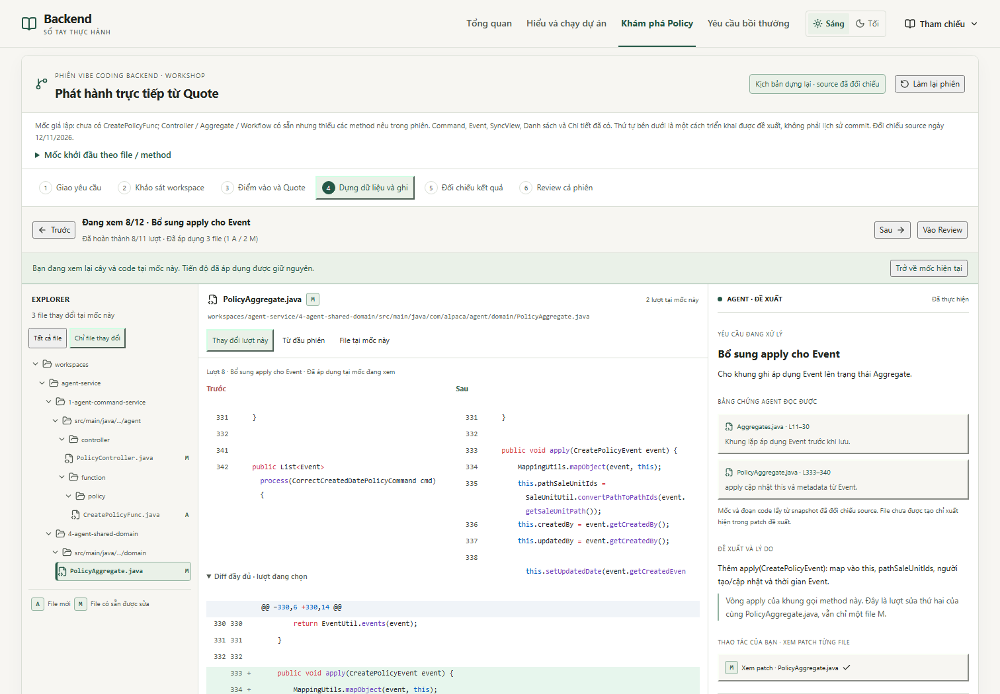
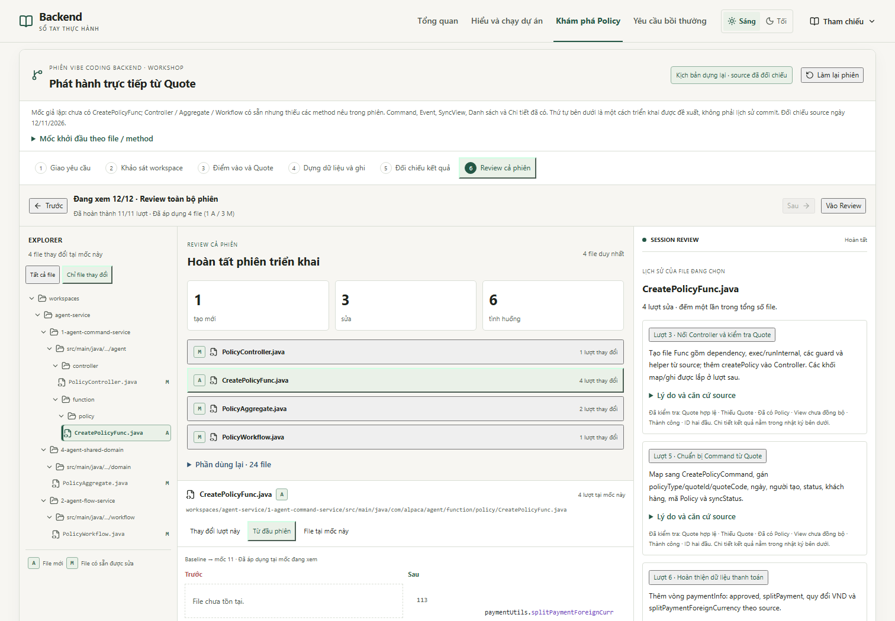

# Mô phỏng cả phiên triển khai · Phát hành trực tiếp từ Quote

[Bắt đầu phiên](http://localhost:3182/journey/policy?group=create&mode=session) · [Review hoàn tất](http://localhost:3182/journey/policy?group=create&mode=session&sessionAt=review&sessionDone=10&sessionFile=func&sessionMode=total&sessionFilter=changed&sessionTrials=entry-valid,entry-missing,entry-blocked,pending,success,read-id) · [IDE tại lượt apply](http://localhost:3182/journey/policy?group=create&mode=session&sessionAt=apply&sessionDone=7&sessionFile=aggregate&sessionMode=round&sessionFilter=changed) · [Xem lại trước save, giữ tiến độ hoàn tất](http://localhost:3182/journey/policy?group=create&mode=session&sessionAt=payment&sessionDone=10&sessionFile=func&sessionMode=file&sessionFilter=changed).

Các liên kết Review/IDE là snapshot có tiến độ fixture sẵn để review giao diện. Đường nghiệm thu bắt đầu từ phiên trống và thao tác trên UI, không dùng tiến độ dựng sẵn.

## Mốc dựng lại và source

Đối chiếu trực tiếp `D:/ALPACA/agent-system` ngày 12/11/2026. GitNexus không có index cho backend này trong session; dùng file thật và SHA256. [Audit](policy-session-source-audit.json) ghi 28 tham chiếu với path, commit và hash. Snapshot `assembly-source.json` được dùng lại; riêng `SearchPolicyFunc.java` đã khác snapshot nên được cập nhật riêng trong `session-source.json`, không thay snapshot của các bài cũ.

Baseline giả lập là một workspace đang lắp dở tính năng: đã có các class và hợp đồng chung, thiếu các method xử lý CreatePolicy bên dưới; riêng `CreatePolicyFunc.java` chưa tồn tại. Đây không phải commit hay lịch sử phát triển được xác minh. Các snapshot trung gian lược vùng chưa lắp, giữ neo số dòng source và chưa phải các bản Java có thể build độc lập. Thứ tự phiên là một cách triển khai được đề xuất.

## Bảng file thực sự thay đổi trong phiên giả lập

Đường dẫn dưới đây tương đối với `workspaces/agent-service/`; `src/main/java/com/alpaca/agent/` được viết gọn thành `…/`.

| A/M | File | Có sẵn tại baseline | Bổ sung trong phiên | Lượt |
| --- | --- | --- | --- | --- |
| A | `1-agent-command-service/…/function/policy/CreatePolicyFunc.java` | Chưa có cả file | Dependency, exec/runInternal, guard và helper L1–79/L160–305; Command L80–104; payment L105–114; save và sau ghi L115–159 | 3, 5, 6, 9 |
| M | `1-agent-command-service/…/controller/PolicyController.java` | Class, imports và mọi route khác, gồm Chi tiết | `createPolicy(String quoteId)` L43–46 | 3 |
| M | `4-agent-shared-domain/…/domain/PolicyAggregate.java` | Class, field, các process/apply khác | `process(CreatePolicyCommand)` L328–331 và `apply(CreatePolicyEvent)` L333–340 | 7, 8 |
| M | `2-agent-flow-service/…/workflow/PolicyWorkflow.java` | Subscriber và các handler khác | `createPolicy(DispatchedEvent<CreatePolicyEvent>)` L23–32 | 10 |

Tổng: **4 file duy nhất, 1 A / 3 M, 8 bản ghi thay đổi theo file**. A/M so với baseline giả lập; không phải trạng thái Git của source Java thật. Kết thúc áp dụng, bốn file materialize đúng toàn bộ rows trong snapshot source đã đối chiếu.

Phần dùng lại gồm 24 file: mẫu CreateQuoteFunc, BaseController/BaseFunc; QuoteRepository/PolicyRepository; CreatePolicyCommand/CreatePolicyEvent; MappingUtils; PlatformConfig/AggregateExtRepository/AggregateRepository; dispatcher/vòng apply/JDBC; QuoteAggregate; PolicySyncViewFunc; PolicyViewEntity/PolicyViewRepository; Query PolicyController/SearchPolicyFunc/QueryCustomRepository; InternalSPCommandApi/InternalPolicyController; FindPolicyByIdFunc. Các helper đặt trong Func mới thuộc A, không được ghi là file có sẵn.

## Đường đi của phiên

1. Giao prompt có thể sao chép: Quote đã lưu, hợp đồng path, guard đã xác minh và tiêu chí kiểm tra.
2. Mở 5 file khảo sát trong cây hoặc từ bằng chứng. Đề xuất hiện sau khi mở đủ; chốt khảo sát không tạo file thay đổi.
3. Xem riêng hai patch Func/Controller rồi áp dụng. Quote ID đi qua HTTP → exec → repository → lock/runInternal/guard. Chưa có save.
4. Chạy Quote hợp lệ, thiếu Quote và đã có Policy RUNNING. Bắt buộc có hợp lệ và thiếu Quote trước khi tiếp tục.
5. Map Quote thành Command, gán trường riêng và gọi helper.
6. Bổ sung thanh toán vào chính Command từ lượt trước.
7. Thêm process: Command → Event, không tự gọi apply.
8. Thêm apply: Event → this. Cùng file Aggregate được tính M một lần, có hai lượt sử dụng.
9. Nối save(command); dùng kết quả Aggregate/ID cho đối tượng bảo hiểm, email/SMS theo source, cập nhật Quote PUBLISHED và return.
10. Nối Workflow với SyncView có sẵn bằng `de.getEntityId()`.
11. Chạy thành công, thử view chưa đồng bộ, nhập Policy ID để đối chiếu Danh sách/Chi tiết.
12. Review: file mới/sửa/dùng lại, diff toàn phiên, lịch sử riêng theo file, lý do/source và nhật ký các kết quả fixture.

## Trạng thái và phạm vi

`sessionAt` là vị trí đang xem; `sessionDone` là lượt đã hoàn thành. Snapshot của mốc cũ không nhận code từ các lượt sau. Diff đề xuất được ghi rõ chưa áp dụng; tab File tại mốc này luôn lấy snapshot đã áp dụng tại mốc đó. Mở mốc tương ứng từ bài lẻ không tự tạo tiến độ. Áp dụng dùng trạng thái URL mới nhất, có gate cho mọi patch và chỉ hoàn thành lượt kế tiếp; nhấn lại không thêm file hoặc lịch sử.

Từ một mốc có thể mở đúng bài Từng bước triển khai và quay lại đúng mốc/vị trí file, giữ tiến độ phiên. Mở bài trực tiếp từ phiên không tự đánh dấu hoàn thành quyết định suy luận. Làm lại phiên là thao tác riêng, không reset bài thực hành lẻ.

Fixture hợp lệ là `QUOTE-LEARN-101`; Policy ID `POL-FROM-QUOTE-LEARN-101`, ngày tham chiếu 08/11/2026, status RUNNING(100). Thiếu Quote dừng `QUOTE_NOT_EXIST`; Quote `QUOTE-LEARN-103` có Policy RUNNING dừng `QUOTE_CAN_NOT_RELEASE_POLICY`. Không thêm guard từ cờ Quote hoặc tự giả định status nghiệp vụ khác.

Thử view chưa đồng bộ cho thấy Policy đã có ở nguồn ghi/Chi tiết nhưng chưa có dòng view cho Danh sách. Sau khi giao Event fixture vào handler, SyncView giả lập có model hợp lệ và lưu một dòng cùng ID. Chưa chạy Java, HTTP nghiệp vụ, DB, Kafka, Core, SMS hoặc email. Source có khối publish rỗng ở đường ghi nên không coi handler là bằng chứng transport đã hoạt động.

## Kiểm chứng

- `node scripts/verify-policy-session-source.mjs --root D:\ALPACA\agent-system`: đối chiếu 28 tham chiếu source/hash. `--refresh` chỉ dùng khi chủ động cập nhật snapshot chênh lệch.
- `tests/browser/policy-session.spec.ts`: kiểm tra snapshot/model và thao tác phiên từ đầu tới Review; A/M, lịch sử nhiều lượt, guard, đối chiếu ID, xem lại trước save, reload, drill-down/return, reset, deep link chưa triển khai và bố cục desktop/mobile sáng/tối.
- `node scripts/capture-policy-session.mjs`: chụp IDE/Review ở desktop 1680×1200 và mobile 390×844, sáng/tối; ghi các link review trong `policy-session-links.json`.

Kết quả build, integrity và browser regression được ghi trong [policy-session-validation.json](policy-session-validation.json).

Build/typecheck đạt; integrity 47 fixture và 28 tham chiếu source đạt. Đã kiểm tra 63 tình huống liên quan: lượt hồi quy đầu có 62 đạt và một lỗi bố cục Toàn cảnh 1366×768; sau khi chuyển nút mở phiên lên hàng chọn cách học, toàn bộ 19 ca bị ảnh hưởng chạy lại đạt. Lượt cuối riêng phiên có 8/8 đạt, gồm đi từ phiên trống đến Review và kiểm tra mốc tương lai chưa lộ patch của các lượt trước. Build còn thông báo kích thước chunk lớn trong bundle Workshop.
